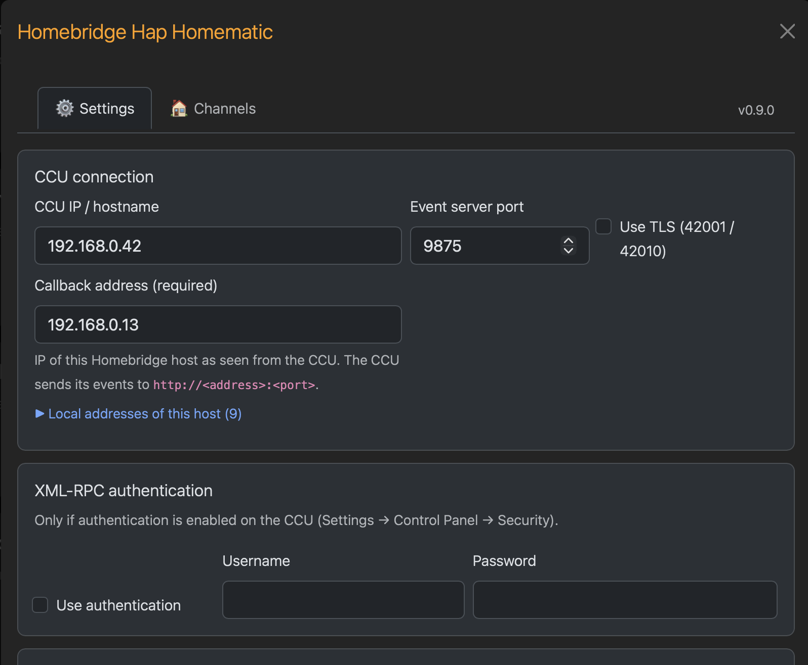
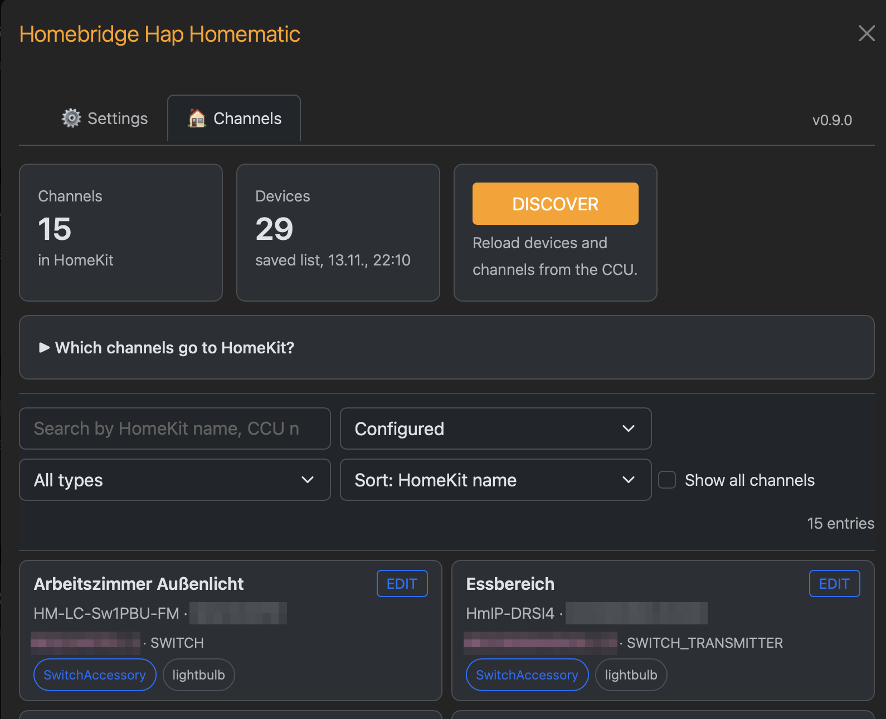

# homebridge-hap-homematic

<!-- Modified by california444 (2026). See NOTICE. -->

A Homebridge plugin that brings **HomeMatic** (BidCos-RF) and
**HomematicIP** (HmIP-RF) devices from a CCU / OpenCCU into Apple Home.

## What it does

- Talks to the CCU's radio services (`rfd`, `HMIPServer`) over
  **XML-RPC only**. It needs no CCU login, no JSON-RPC and no ReGa
  scripts, and nothing is installed on the CCU.
- **Events in real time.** The CCU pushes state changes to the plugin. A
  ping/PONG watchdog checks each interface, and the plugin subscribes
  again after a CCU restart.
- **You choose what goes to HomeKit.** The custom UI lists the devices
  found on the CCU. You add single channels, or for an irrigation
  system the whole device, and pick the HomeKit service and its options.
- **Services:** switch, outlet, light, dimmer, tunable white, RGB,
  blind / shutter (also with slats), garage door, door opener, lock,
  thermostat, contact, motion, smoke, leak, temperature, humidity,
  weather station, energy meter, push button / remote, doorbell and
  **irrigation system with several valves**.
- **Heating groups** of the CCU (Settings → Groups) as one HomeKit
  thermostat each, via the CCU's VirtualDevices interface (optional,
  beta). A change in Home goes to the group, and the CCU passes it on to
  every member. See [Heating groups](#heating-groups).
- HomematicIP specifics are handled for you: transmitter / receiver
  channel groups, `SMOKE_DETECTOR_ALARM_STATUS`, built-in buttons of
  actuators hidden in the UI.
- Accessory information in Home shows the device type as model and the
  device serial as serial number.
- Optional TLS (ports 42001 / 42010 / 49292) and Basic auth on the XML-RPC ports.

## What it does not do

- No CCU system variables, programs, rooms or favourites. These need
  JSON-RPC / ReGa, which the plugin deliberately does not use.
- No automatic import: nothing appears in Home until you add it in the UI.
- No Homematic IP cloud (Access Point / HCU) and no wired interfaces.
  Supported are BidCos-RF and HmIP-RF on a CCU / OpenCCU, plus heating
  groups (VirtualDevices). Other group types, CUxD and group names or
  member lists are not read.
- No cameras.

## Why HAP and not Matter

HomeKit Accessory Protocol (HAP) through Homebridge is a deliberate
choice. Apple Home supports only part of the Matter device types, and many
HomeMatic devices have no counterpart there. One example is an
irrigation system with several valves and run times. Over HAP, Apple Home
offers the full set of services: IrrigationSystem with Valves, Doorbell,
Stateless Programmable Switch, slats, battery and fault states.

## How it differs from other plugins

|                            | homebridge-hap-homematic                                 | Other HomeMatic plugins for Homebridge / CCU add-ons   |
| -------------------------- | -------------------------------------------------------- | ------------------------------------------------------ |
| CCU access                 | XML-RPC only, no login                                   | often JSON-RPC / ReGa with a CCU user                  |
| Runs on                    | Homebridge, one child bridge                             | Homebridge (partly several bridges) or as a CCU add-on |
| Configuration              | custom UI, channel by channel, stored in `devices.json`  | config.json lists or the add-on's UI                   |
| System variables, programs | no                                                       | yes, in some of them                                   |
| Irrigation                 | IrrigationSystem with valves, fixed or Home-set run time | depends on the plugin                                  |

## Screenshots

**Settings:** CCU address, callback address, authentication, connection test.

**Channels:** discovered devices, filter, add a channel to HomeKit.

## Status

Actively developed and in daily use. The core (connection, events,
discovery, UI) is stable; device support grows with feedback. Until
1.0, details of the configuration may still change; changes are listed
in the
[release notes](https://github.com/california444/homebridge-hap-homematic/releases).

## Tested devices

Tested on real hardware with an OpenCCU:

| Device          | Interface | Service                      |
| --------------- | --------- | ---------------------------- |
| HM-LC-Sw1PBU-FM | BidCos-RF | Switch / Light               |
| HM-LC-Sw1-DR    | BidCos-RF | Switch / Light               |
| HM-LC-Sw4-DR-2  | BidCos-RF | Irrigation system (4 valves) |
| HM-LC-Bl1PBU-FM | BidCos-RF | Blind                        |
| HM-Sec-SCo      | BidCos-RF | Contact sensor               |
| HmIP-PS         | HmIP-RF   | Switch / Outlet              |
| HmIP-DRSI4      | HmIP-RF   | Switch / Light (4 outputs)   |
| HmIP-BROLL      | HmIP-RF   | Blind                        |
| HmIP-SWSD       | HmIP-RF   | Smoke detector               |
| HmIP-DSD-PCB    | HmIP-RF   | Doorbell                     |

The other services are implemented and unit-tested, but have not been
checked on real devices yet. Reports are welcome as an
[issue](https://github.com/california444/homebridge-hap-homematic/issues).
Mapping details per device: [docs/DEVICES.md](docs/DEVICES.md).

## Heating groups

A heating group links thermostats on the CCU, e.g. a wall thermostat with
radiator thermostats. Mapped as one thermostat, a change in Home reaches
every member, just like a change made at the wall thermostat.

1. Settings → CCU connection → Interfaces: tick **VirtualDevices (heating
   groups)** (off by default). Port 9292 (TLS 49292) of the CCU must be
   reachable from the Homebridge host.
2. **Discover**. Groups appear with their address (`INT0000001` …) and
   type (`HmIP-HEATING` or `HM-CC-VG-1`). The CCU does not pass group
   names over XML-RPC; the name is in the CCU under Settings → Groups.
3. Add channel 1 of the group as **Thermostat**, give it a name and
   restart the child bridge.

Only channel 1 is offered; the other channels of a group mirror its
members. The battery shows "normal" until a member reports low battery.
Humidity appears only with the thermostat option **Show humidity**, which
is useful only if a wall thermostat with a sensor is a member.

**Beta diagnostics.** While groups are in beta, the plugin logs every
write to a group, the events that follow, a read-back after 3 s and the
start values, each line marked `[group-diag]`. To help, change the target
temperature and mode of a group in Home a few times and attach the output
of `grep group-diag` from the Homebridge log to
[issue #42](https://github.com/california444/homebridge-hap-homematic/issues/42).
These lines will be removed again in a later version.

## Requirements

- Node.js 22 or newer (tested with 22, 24 and 26)
- Homebridge ≥ 2.4.0
- CCU / OpenCCU with the XML-RPC ports reachable from the Homebridge host
  (default 2001 for BidCos-RF, 2010 for HmIP-RF, 9292 for heating groups
  if enabled), and the plugin's event
  server port (default 9875) reachable from the CCU. The event server only
  accepts callbacks from the configured CCU address, so the CCU must reach
  Homebridge directly, not through NAT or a proxy.

## Acknowledgements

Built on the work of [mattein](https://github.com/matthiaseinig)
(Homebridge-Homematic-HAP) and [thkl](https://github.com/thkl)
(hap-homematic, homebridge-homematic). See [NOTICE](NOTICE) for the full
attribution.

## License

Apache-2.0, see [LICENSE](LICENSE) and [NOTICE](NOTICE).
